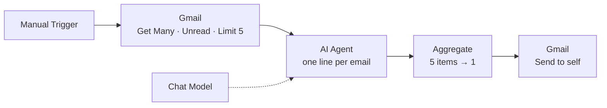

# Unread Email Summariser — n8n AI Agent for Gmail

An n8n workflow that picks up the latest **5 unread emails** from Gmail, asks an AI model to describe each one in a **single line**, and emails all five summaries back to me as **one message**.

> Social Eagle · Gen AI Architect Program · Week 4, Day 1 assignment

---

## How it works



1. **Manual Trigger** — runs the workflow on demand.
2. **Gmail (Get Many)** — fetches the 5 most recent unread messages. Returns 5 separate items.
3. **AI Agent + Chat Model** — runs once per item and writes a one-line summary (20 words max) into a field called `output`.
4. **Aggregate** — collects the 5 `output` values into a single item holding an array of 5 lines.
5. **Gmail (Send)** — joins the lines and sends them to my own address in one email.

---

## Node settings

### 1. Gmail — Get Many
| Setting | Value |
|---|---|
| Resource | Message |
| Operation | Get Many |
| Return All | Off |
| Limit | 5 |
| Simplify | On |
| Filters → Read Status | Unread |

### 2. AI Agent
| Setting | Value |
|---|---|
| Source for Prompt | Define below |
| Chat Model | `<model you used, e.g. Google Gemini / OpenAI>` |

Prompt:
```
Write ONE line (20 words maximum) describing this email.
No greeting, no heading, no extra text.
From: {{ $json.From }}   Subject: {{ $json.Subject }}
Preview: {{ $json.snippet }}
```

### 3. Aggregate
| Setting | Value |
|---|---|
| Aggregate | Individual Fields |
| Input Field Name | `output` |

### 4. Gmail — Send
| Setting | Value |
|---|---|
| Resource | Message |
| Operation | Send |
| To | my own Gmail address |
| Subject | `Your 5 unread emails` |
| Email Type | Text |
| Message | `{{ $json.output.join('\n\n') }}` |
| Append n8n Attribution | Off |

---

## Design decisions

**Where do five results become one?**
The Gmail node outputs 5 items, and every node after it runs once per item — so without intervention the workflow would send 5 emails. The **Aggregate** node is where the five AI outputs are merged into a single item, so the final Gmail node runs exactly once.

**What does the AI actually need?**
Only the **sender, subject and snippet** (Gmail's short preview). That is enough to describe an email in one line, and it keeps each request small, fast and cheap compared with sending the full body.

**Gotchas I hit**
- With *Simplify* on, Gmail returns capitalised headers — `From` and `Subject` — so `$json.from` / `$json.subject` come out empty. Field names must match the output panel exactly.
- The Send node's Email Type must be **Text**; in HTML mode the `\n\n` line breaks are ignored and all summaries run together.

---

## Sample output

```
Subject: Your 5 unread emails

<paste one line from your actual summary email>
<line 2>
<line 3>
<line 4>
<line 5>
```

---

## Setup (to run it yourself)

### Prerequisites
- n8n (n8n Cloud, or self-hosted via `npx n8n` → `http://localhost:5678`)
- A Google account
- An API key for an AI chat model (e.g. Google Gemini or OpenAI)

### 1. Google Cloud — Gmail OAuth
1. In Google Cloud Console, create a project and **enable the Gmail API**.
2. In **Google Auth Platform**, configure the consent screen with **Audience: External**.
3. Under **Audience → Test users**, add your own Gmail address.
4. Under **Clients**, create an OAuth client of type **Web application**, and add n8n's **OAuth Redirect URL** to *Authorized redirect URIs*.
5. In n8n, create a Gmail credential, paste the **Client ID** and **Client Secret**, then click **Sign in with Google**.

### 2. Chat model credential
Create a credential in n8n for your chat model provider and paste the API key there. No keys are stored in the workflow itself.

### 3. Import and run
1. In n8n: **Workflows → Import from File** → select `Unread_Email_Summariser.json`.
2. Re-select your own Gmail and chat model credentials on the nodes (credentials are not included in the export).
3. Set the **To** address on the final Gmail node to your own email.
4. Click **Execute workflow** and check your inbox.

---

## Repository contents

```
├── Unread_Email_Summariser.json   # exported n8n workflow
├── screenshots/
│   ├── workflow-canvas.png        # the workflow on the n8n canvas
│   └── summary-email.png          # the summary email in my inbox
└── README.md
```

## Screenshots


## Demo video

`<link to your screen recording in the community>`

---

## Security note

API keys and Google OAuth secrets live only in **n8n credentials**. The exported JSON contains credential *names* only, never the secrets. Pinned test data was removed before export so no email content is published.

---

**Author:** `<your name>` · Social Eagle Gen AI Architect Program# unread-email-summariser
Build an n8n AI Agent for Gmail
